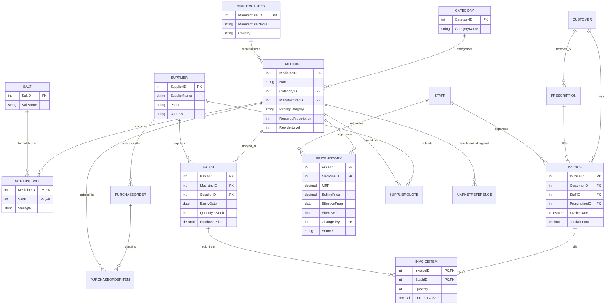

# Chapter 4: Relational Schema & Entity Relationship Diagram (ERD)

## 4.1 Final Relational Schema (BCNF)

1. **Category** ($\underline{\text{CategoryID}}\text{ PK}, \text{CategoryName}$)
2. **Manufacturer** ($\underline{\text{ManufacturerID}}\text{ PK}, \text{ManufacturerName}, \text{Country}$)
3. **Medicine** ($\underline{\text{MedicineID}}\text{ PK}, \text{Name}, \text{CategoryID}\text{ FK}, \text{ManufacturerID}\text{ FK}, \text{PricingCategory}, \text{RequiresPrescription}, \text{ReorderLevel}$)
4. **Salt** ($\underline{\text{SaltID}}\text{ PK}, \text{SaltName}$)
5. **MedicineSalt** ($\underline{\text{MedicineID}\text{ FK}, \text{SaltID}\text{ FK}}\text{ PK}, \text{Strength}$)
6. **Supplier** ($\underline{\text{SupplierID}}\text{ PK}, \text{SupplierName}, \text{Phone}, \text{Address}$)
7. **Batch** ($\underline{\text{BatchID}}\text{ PK}, \text{MedicineID}\text{ FK}, \text{SupplierID}\text{ FK}, \text{ExpiryDate}, \text{QuantityInStock}, \text{PurchasePrice}$)
8. **PurchaseOrder** ($\underline{\text{POID}}\text{ PK}, \text{SupplierID}\text{ FK}, \text{OrderDate}, \text{Status}$)
9. **PurchaseOrderItem** ($\underline{\text{POID}\text{ FK}, \text{MedicineID}\text{ FK}}\text{ PK}, \text{Quantity}, \text{Cost}$)
10. **Customer** ($\underline{\text{CustomerID}}\text{ PK}, \text{CustomerName}, \text{Phone}$)
11. **Prescription** ($\underline{\text{PrescriptionID}}\text{ PK}, \text{CustomerID}\text{ FK}, \text{DoctorName}, \text{PrescriptionDate}$)
12. **Staff** ($\underline{\text{StaffID}}\text{ PK}, \text{StaffName}, \text{Role}, \text{Username}\text{ UNIQUE}, \text{PasswordHash}$)
13. **Invoice** ($\underline{\text{InvoiceID}}\text{ PK}, \text{CustomerID}\text{ FK}, \text{StaffID}\text{ FK}, \text{PrescriptionID}\text{ FK NULL}, \text{InvoiceDate}, \text{TotalAmount}$)
14. **InvoiceItem** ($\underline{\text{InvoiceID}\text{ FK}, \text{BatchID}\text{ FK}}\text{ PK}, \text{Quantity}, \text{UnitPriceAtSale}$)
15. **PriceHistory** ($\underline{\text{PriceID}}\text{ PK}, \text{MedicineID}\text{ FK}, \text{MRP}, \text{SellingPrice}, \text{EffectiveFrom}, \text{EffectiveTo}, \text{ChangedBy}\text{ FK}, \text{Source}$)
16. **SupplierQuote** ($\underline{\text{QuoteID}}\text{ PK}, \text{SupplierID}\text{ FK}, \text{MedicineID}\text{ FK}, \text{QuotedPrice}, \text{QuoteDate}$)
17. **MarketReference** ($\underline{\text{RefID}}\text{ PK}, \text{MedicineID}\text{ FK}, \text{AvgMarketPrice}, \text{Source}, \text{RecordedDate}$)

---

## 4.2 Entity Relationship Cardinality Table

| Parent Entity | Child Entity | Cardinality | Implementation / Mechanism |
| :--- | :--- | :---: | :--- |
| **Category** | Medicine | $1 : M$ | `Medicine.CategoryID` references `Category.CategoryID` |
| **Manufacturer** | Medicine | $1 : M$ | `Medicine.ManufacturerID` references `Manufacturer.ManufacturerID` |
| **Medicine** | Batch | $1 : M$ | `Batch.MedicineID` references `Medicine.MedicineID` |
| **Supplier** | Batch | $1 : M$ | `Batch.SupplierID` references `Supplier.SupplierID` |
| **Medicine** | Salt | $M : N$ | Resolved via `MedicineSalt` junction table |
| **Invoice** | Batch | $M : N$ | Resolved via `InvoiceItem` junction table |
| **PurchaseOrder** | Medicine | $M : N$ | Resolved via `PurchaseOrderItem` junction table |
| **Customer** | Invoice | $1 : M$ | `Invoice.CustomerID` references `Customer.CustomerID` |
| **Customer** | Prescription | $1 : M$ | `Prescription.CustomerID` references `Customer.CustomerID` |
| **Staff** | Invoice | $1 : M$ | `Invoice.StaffID` references `Staff.StaffID` |
| **Medicine** | PriceHistory | $1 : M$ | `PriceHistory.MedicineID` references `Medicine.MedicineID` |
| **Supplier & Medicine** | SupplierQuote | $M : N$ | M:N association with price attribute in `SupplierQuote` |

---

## 4.3 Visual Entity-Relationship Diagram (ERD)

